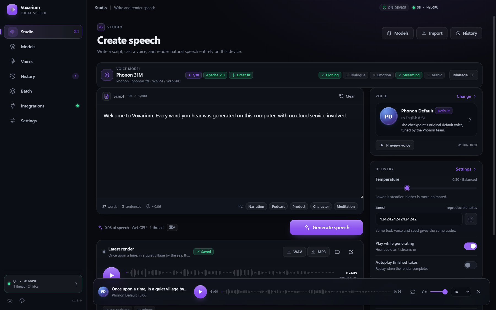
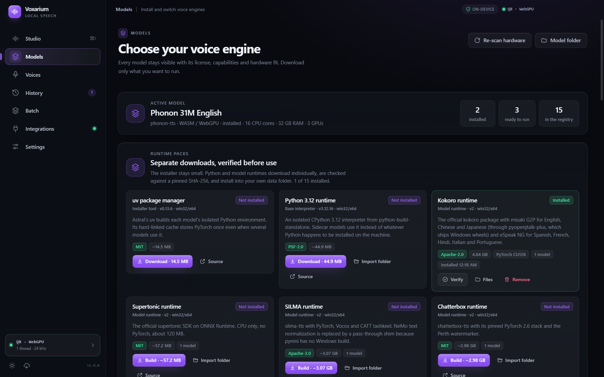
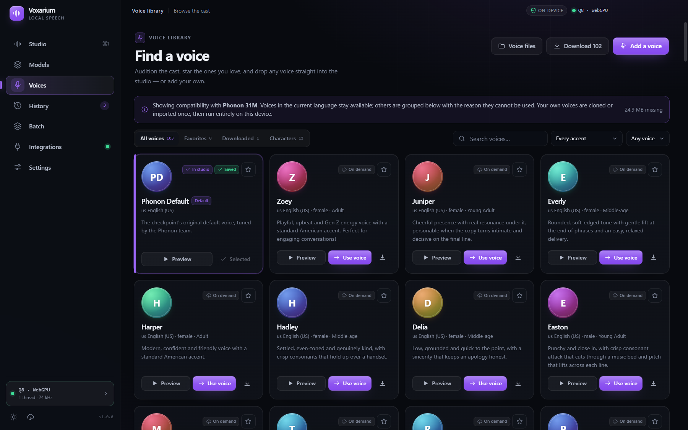
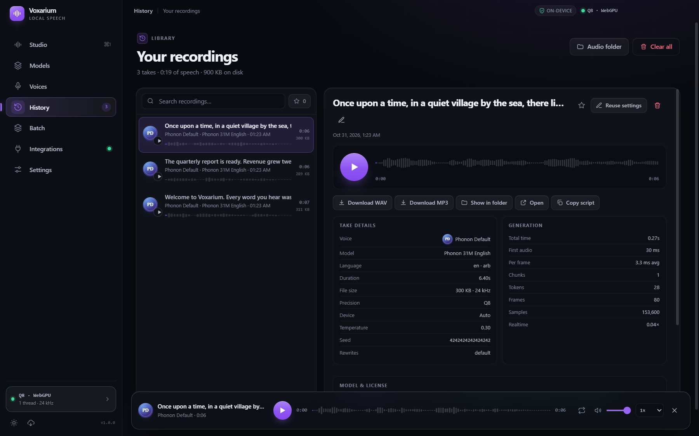
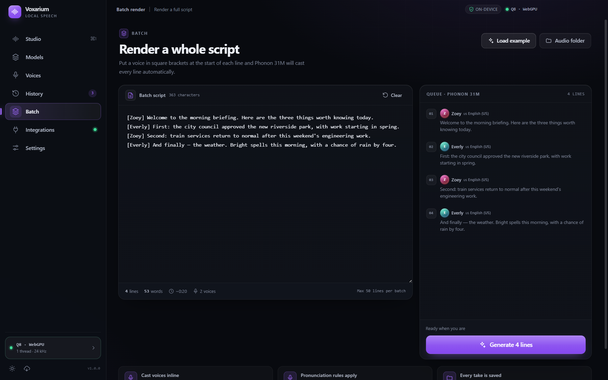
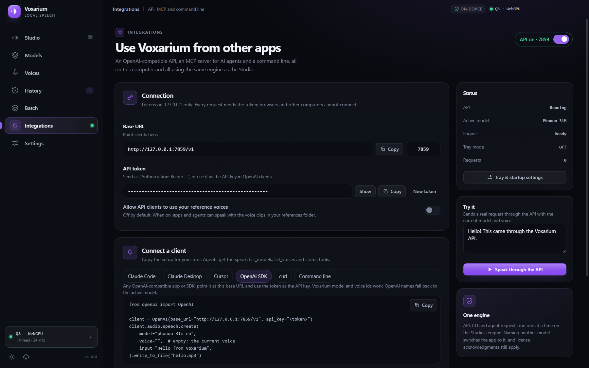
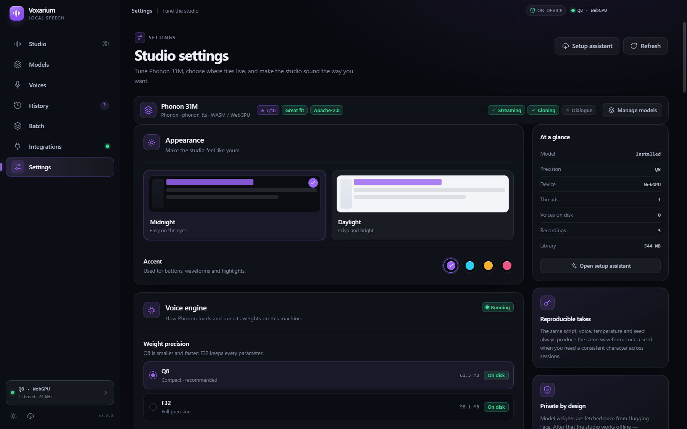
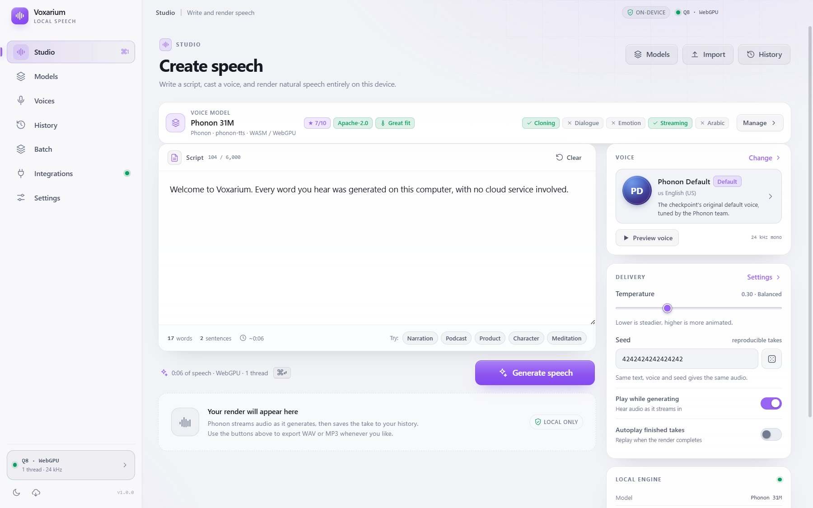

<div align="center">


# Voxarium

**A private, on-device text-to-speech studio for Windows.**

Write a script, cast a voice and render natural speech, all on your own machine.
No cloud service, no account and no upload.


[Features](#features) · [Screenshots](#screenshots) · [Install](#install) ·
[Integrations](#use-it-from-other-apps) · [Development](#development)

<br />



</div>

## Why Voxarium

- **Local by default.** Speech generation, voice files, history and exports never leave
  your computer. After the one-time model download, Voxarium works fully offline.
- **Many engines, one app.** Choose from 15 curated TTS models. Each one shows its
  license, capabilities and how well it fits your hardware before you download anything.
- **Built for real work.** Use batch scripts with per-line voices, reproducible seeds,
  pronunciation rules, WAV/MP3 export, and an OpenAI-compatible API for your other tools.

## Features

| | |
| --- | --- |
| 🎙️ **Studio** | Write a script, pick a voice, tune temperature and seed, and hear the speech as it streams in. |
| 🧩 **Model registry** | 15 curated TTS models with license, capability, hardware-fit and quality scores. Phonon runs inside the app. The others run in a local Python sidecar whose environment (uv, CPython, CUDA or CPU PyTorch) is built on your computer from a pinned recipe. |
| 🧭 **First-run chooser** | The setup assistant lists every model with its fit, license and runtime status, then installs the one you pick with verified downloads. Gated models (Phonon 40M, OpenAudio) need a Hugging Face token in Settings. |
| 🗣️ **103 voices** | Search, filter by accent and gender, star favorites, preview and cast with one click. Voices are grouped by model compatibility, so you can't select one the active model doesn't support. |
| 📚 **History** | Every take is saved with its model, license and generation stats. You can replay, rename, favorite, reuse, export or reveal any take in its folder. |
| 📜 **Batch** | Render up to 50 lines in one pass. Cast a voice per line with a `[Voice Name]` prefix, check the queue against the active model, then export every result at once. |
| 🎛️ **Voice controls** | Q8/F32 precision, Auto/CPU/WebGPU device, thread count, language normalization, rewrite rules, speaking conditions, pronunciation overrides and reproducible seeds. Controls a model doesn't support are disabled, with the reason shown. |
| 💾 **Export** | WAV or MP3, with a configurable filename template and default export folder. |
| 🔌 **API, MCP and CLI** | An OpenAI-compatible API on `127.0.0.1`, an MCP server for AI agents, and a command line, all using the same engine as the Studio. Optional tray mode keeps it running in the background. |
| 🎨 **Polished shell** | Dark and light themes, four accent colors, a global player with speed and volume controls, remembered window state, and a keyboard shortcut for every page (<kbd>Ctrl</kbd>+<kbd>1</kbd>–<kbd>7</kbd>). |
| 🔒 **Privacy gates** | SHA-256-verified downloads, atomic per-model installs, acknowledgments for restricted licenses, loopback-only sidecars, and explicit consent before cloud voice cloning. |

## Screenshots

<table>
  <tr>
    <td width="50%"><br /><sub><b>Models</b>: install and switch engines; every runtime is verified before use.</sub></td>
    <td width="50%"><br /><sub><b>Voices</b>: audition, filter, favorite and cast the 103-voice library.</sub></td>
  </tr>
  <tr>
    <td><br /><sub><b>History</b>: every take, with its settings and generation stats.</sub></td>
    <td><br /><sub><b>Batch</b>: cast a voice per line and render a whole script.</sub></td>
  </tr>
  <tr>
    <td><br /><sub><b>Integrations</b>: an OpenAI-compatible API, MCP and CLI on localhost.</sub></td>
    <td><br /><sub><b>Settings</b>: themes, accents, precision, device and storage.</sub></td>
  </tr>
  <tr>
    <td colspan="2" align="center"><br /><sub>The Studio in the <b>Daylight</b> theme.</sub></td>
  </tr>
</table>

## Install

**Requirements:** Windows 10 or 11 (x64). A GPU is optional. Phonon 31M runs on the
CPU or through WebGPU, and the sidecar models use CUDA when it's available.

If an installer is attached to a [GitHub release](https://github.com/AhmadMansy/voxarium/releases),
download and run it. Otherwise, build one from source:

```powershell
git clone https://github.com/AhmadMansy/voxarium.git
cd voxarium
npm.cmd install
npm.cmd run pack     # writes release\Voxarium Setup 1.0.0.exe
```

Run `release\Voxarium Setup 1.0.0.exe`, or launch the portable build at
`release\win-unpacked\Voxarium.exe`. The build is unsigned, so Windows SmartScreen may ask
you to confirm before it runs.

**First launch.** The model chooser opens. Installing Phonon 31M downloads its verified
Q8 weights and default voice into `%APPDATA%\Voxarium`. After that, generating speech
doesn't need a network connection.

> **Upgrading from Phonon Studio?** On first launch, Voxarium adopts the existing
> `%APPDATA%\Phonon Studio` folder, so your models, voices, settings and history carry over.

## Use it from other apps

Turn on the local API on the **Integrations** page. Then any OpenAI-compatible client
can generate speech with the same engine and active model as the Studio:

```python
from openai import OpenAI

client = OpenAI(base_url="http://127.0.0.1:7849/v1", api_key="<token>")
client.audio.speech.create(
    model="phonon-31m-en",
    voice="",  # empty: the current voice
    input="Hello from Voxarium",
).write_to_file("hello.mp3")
```

The Integrations page also has copy-ready setup for **Claude Code**, **Claude Desktop**,
**Cursor**, **curl** and the **command line**. The API listens on `127.0.0.1` only, and
every request needs the token. See [`docs/integrations.md`](docs/integrations.md) for the
full reference.

## Models and trust

All model files are pinned to specific Hugging Face revisions. Before use, each file is
checked against its expected size and SHA-256 hash. The local model server binds only to
`127.0.0.1`. See [`docs/model-support.md`](docs/model-support.md) for the shipped model
matrix, runtime limits, license and capability gates, and test coverage.

### Local data

| Path | Contents |
| --- | --- |
| `%APPDATA%\Voxarium\models\<id>` | Verified model weights, tokenizer, config and default voice |
| `%APPDATA%\Voxarium\voices` | Downloaded voice embeddings |
| `%APPDATA%\Voxarium\voices\custom` | Imported or cloned custom voices |
| `%APPDATA%\Voxarium\audio` | Generated WAV recordings |
| `%APPDATA%\Voxarium\history.json` | Recording metadata |

You can clear model and voice downloads from Settings without touching your recordings.

## Development

```powershell
npm.cmd install
npm.cmd run dev        # Vite renderer + Electron
npm.cmd run typecheck  # TypeScript only
npm.cmd run build      # typecheck + production bundle
npm.cmd test           # model registry/fit/license/preference checks
npm.cmd run test:e2e   # Electron model lifecycle (requires a built app)
npm.cmd run pack       # build + NSIS installer
```

The renderer is React 19 + Vite. The Electron main process serves the model and voice
files from a small localhost HTTP server, so the Rust/WASM worker can fetch them with
range requests. The app itself is served over the isolated `app://` protocol.

### Project layout

```
electron/        Electron main process, preload bridge, local model server
src/             React renderer
  pages/         Studio, Models, Voices, History, Batch, Integrations, Settings
  components/    Player bar, setup wizard, shared UI
  lib/           Engine, ONNX/sidecar clients, audio encoding, catalog, utilities
  models/        Registry, fit, license, compatibility and preference logic
  styles/        Stylesheet partials
public/phonon/   Pinned Phonon runtime copied in by scripts/sync-phonon.mjs
public/ort/      Pinned ONNX Runtime Web assets copied in by scripts/sync-ort.mjs
scripts/         Build-time asset scripts and the unit/E2E test runners
docs/            Integration guide, model support matrix, screenshots
```

## Credits

Phonon 31M by [Gradium](https://gradium.ai/phonon), Apache-2.0. Voice embeddings from
[gradium/phonon-voices](https://huggingface.co/gradium/phonon-voices). Each additional
model keeps its own license, which Voxarium shows before install.
